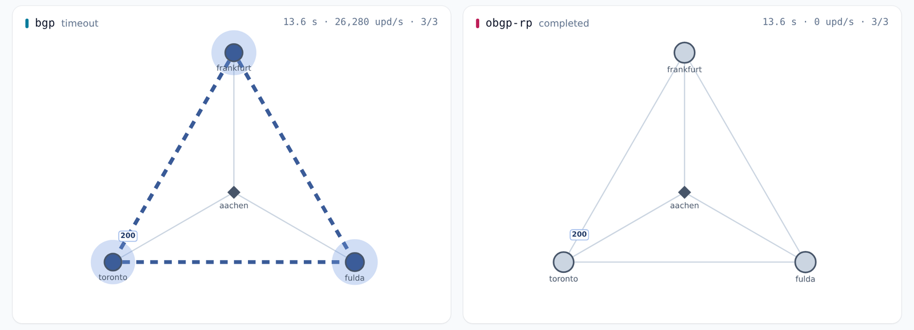

<p align="center">
  <picture>
    <source srcset="assets/logo-router-dark.png" media="(prefers-color-scheme: dark)">
    
  </picture>
</p>

<p align="center"><b>An oscillation-free BGP router based on <a href="https://github.com/osrg/gobgp">GoBGP</a>,<br>
and the lab that measures it.</b></p>

<p align="center">
<a href="https://doi.org/10.23919/IFIPNetworking70592.2026.11578986">IFIP Networking 2026</a> ·
<a href="https://opendl.ifip-tc6.org/db/conf/networking/networking2026/1571247489.pdf">Paper</a> ·
<a href="vis">Figures</a> ·
<a href="results/public/ifip-networking-2026">Data</a>
</p>

Preference cycles make BGP oscillate. OBGP ([LCN 2022](https://doi.org/10.1109/LCN53696.2022.9843706),
[ICC 2022](https://doi.org/10.1109/ICC45855.2022.9839159)) orders route import and export strictly,
so that under the assumptions of its proof it cannot. BGP messages stay as they are.

- **Router:** gobgpd with OBGP, every part switchable back to the paper's code.
- **Lab:** BGP and OBGP on real routers in Kubernetes, from topology to statistics.
- **Agents:** AI assistants operate the lab over MCP, with a person approving each change.
- **Simulator:** gobgpd's decision code on every small network, to find where OBGP deviates from BGP, replayed step by step in the lab's Simulation area.

## How it works

Paths are ordered by AS path length, ties broken by ASN.

- **Import:** a path is admitted only if it is better than the worst admitted one.
- **Export:** peers get the worst admitted path, so a better one never changes what they see.
- **Pruning:** a withdrawn or changed path sets aside the paths containing its old AS sequence.
- **Re-admission:** once no valid path is left, set-aside paths come back as their neighbors answer a route refresh.
- **Per neighbor (optional):** a table per eBGP neighbor, each exporting the worst path that neighbor may get.
- **iBGP:** paths from the own AS skip the import filter but count for the threshold.
- **Forwarding:** the FIB gets GoBGP's usual best path, loop-free once routes settle.

What it costs: [Limitations](#limitations).

## Results

The paper's results: [paper](https://opendl.ifip-tc6.org/db/conf/networking/networking2026/1571247489.pdf),
[figures](vis), [data](results/public/ifip-networking-2026).

`obgp-rp`, the default since the paper, has no published lab results yet. These experiments measure it:

| Question | Experiment |
|---|---|
| Does OBGP converge where BGP oscillates, in every mode? | [`behaviour-oscillation`](experiments/behaviour-oscillation.yaml) |
| Does it still converge, and how fast, with an MRAI of 30 s? | [`behaviour-mrai`](experiments/behaviour-mrai.yaml) |
| Does it stay stable under failures? | [`behaviour-failures`](experiments/behaviour-failures.yaml) |
| Do Gao-Rexford policies hold, also in partial deployment, and does every router keep what BGP reaches? | [`semantics-gao-rexford`](experiments/semantics-gao-rexford.yaml) |
| Does it keep BGP's semantics in the cases of the Go tests? | [`semantics-adversarial`](experiments/semantics-adversarial.yaml) |
| Where does it fail outside its model or inside an AS? | [`semantics-limits`](experiments/semantics-limits.yaml) |
| Does it scale to 256 networks of the Internet's core? | [`internet-scale`](experiments/internet-scale.yaml) |
| Does it hold full tables? | [`internet-dfz`](experiments/internet-dfz.yaml) |
| Does the lab work? | [`lab-smoke`](experiments/lab-smoke.yaml) |
| Does it run every feature? | [`lab-features`](experiments/lab-features.yaml) |
| Does it measure right? | [`lab-calibration`](experiments/lab-calibration.yaml) |
| Does sampling change what it measures? | [`lab-sampling`](experiments/lab-sampling.yaml) |

## Lab

<p align="center">
  <picture>
    <source srcset="assets/readme/process-dark.svg" media="(prefers-color-scheme: dark)">
    
  </picture>
</p>

Like Containerlab, Kathará and Mininet, the lab runs real daemons, one Kubernetes pod per router. It adds:

- **Experiments as files:** each result keeps its inputs, seeds and software versions.
- **Statistics:** medians with exact intervals, and paired variants with Wilcoxon tests.
- **Scenarios:** steps that announce, withdraw, fail links, change policies and check forwarding.
- **Problems:** every run is checked for rest, loops and black holes at rest and on the way, reach and policy against BGP of the same seed, and session drops.
- **Topologies:** drawn, generated, or imported from [SNDlib](https://sndlib.put.poznan.pl) and
  [CAIDA](https://www.caida.org/catalog/datasets/as-relationships/).
- **Internet data:** full tables and updates from [RIPE RIS](https://ris.ripe.net).
- **Agents:** read results, write experiments and run the queue. See [docs/agents.md](docs/agents.md).

<p align="center">
  <picture>
    <source srcset="assets/readme/replay-dark.png" media="(prefers-color-scheme: dark)">
    
  </picture>
  <br><sub>A replay of BAD GADGET: BGP keeps sending updates, OBGP has come to rest.</sub>
</p>

One command sets it up on a Linux host with Docker. Then open the printed address and run `lab-smoke`.

```bash
git clone https://github.com/Stinktopf/gobgp.git && cd gobgp/scripts && ./setup.sh
```

Operation, host sizes and metrics: [docs/lab.md](docs/lab.md).

## Simulator

It plays one prefix between routers that run gobgpd's decision code, in the lab's modes.

- **Exhaustive:** every connected topology up to five routers, with three message orders each.
- **Policies:** every family the router supports, e.g. Local Preference, filters and Gao-Rexford.
- **Counterexamples:** each network where a mode loses a route or loops, replayable message by message.
- **Fuzzing:** larger networks, sampled.
- **Simulation area:** a search starts from the web UI and waits in the lab's queue. Each problem plays message by message, BGP beside an OBGP mode.
- **With the lab:** a case becomes an experiment of every mode with one click, and its runs show beside it.

What it found: [DESIGN.md](DESIGN.md#what-the-router-supports). Running it: [docs/simulator.md](docs/simulator.md).

## Threats to validity

- **One host:** all routers share its CPUs.
- **Load:** each result marks the runs where the host or a router's sampling was at its limit.
- **Resolution:** times are exact to two sampling intervals, 0.2 s at 10 Hz.
- **Internet runs:** 256 routers sample at 1 Hz, so their times are exact to 2 s.
- **Few runs:** ten per cell, six for the Internet runs, so the interval of a median reaches 97.9 or 96.9 %.
- **Many cells:** each experiment names one primary comparison, Holm-corrected across its cells.
- **Exploratory:** all other tests are uncorrected.
- **CAIDA:** its relations are inferred, and some are wrong.
- **Simulator:** one prefix, no timers, small networks enumerated rather than the Internet sampled.
- **Simulator and lab:** the lab cannot replay the simulator's order of messages, so a case it found in few orders may not show in a lab run.

## Usage

```bash
go build -o . ./cmd/gobgpd ./cmd/gobgp
GOBGP_OPERA_ENABLED=true ./gobgpd -f gobgpd.conf
```

Without `GOBGP_OPERA_ENABLED` the daemon is plain GoBGP. The code is in
[`opera.go`](internal/pkg/table/opera.go), configuration and CLI are
[GoBGP's](docs/sources/getting-started.md).

### Settings

| Variable | Sets | Default | Other | The paper's |
|---|---|---|---|---|
| `GOBGP_OPERA_PRUNING` | how pruned paths come back | `refresh` | `soft`, `hard`, `off` | `hard` |
| `GOBGP_OPERA_REFRESH_S` | seconds between refreshes to one neighbor | `1` | | |
| `GOBGP_OPERA_REFRESH_DELAY_S` | seconds the first refresh waits | `0` | | |
| `GOBGP_OPERA_IBGP` | how iBGP paths are admitted | `native` | `filter` | `filter` |
| `GOBGP_OPERA_AS_SET` | the order inside an `AS_SET` | `canonical` | `received` | `received` |
| `GOBGP_OPERA_CONFED` | confederation hops in the order | `count` | `ignore` | `ignore` |
| `GOBGP_OPERA_RS` | what a route server does | `transparent` | `admit` | `admit` |
| `GOBGP_OPERA_EXPORT` | tables for the export | `one` | `neighbor` | `one` |

### Modes

Lab and simulator name the same modes:

| Mode | Routers run |
|---|---|
| `bgp` | GoBGP's standard selection |
| `obgp-rp` | OBGP with every setting at its default |
| `obgp-rp-pn`, `obgp-sp-pn`, `obgp-hp-pn`, `obgp-np-pn` | the pruning mode with a table per eBGP neighbor |
| `obgp-sp`, `obgp-hp`, `obgp-np` | the same with soft, hard or no pruning |
| `obgp-paper` | OBGP with every setting as the paper's |
| `hybrid-…`, `random-…` | one of these on some routers, BGP on the others |

`obgp-rp-pn` is the variant `{mode: obgp-rp, per_neighbor: true}` in the experiments, each pruning
mode runs with and without tables per neighbor, `obgp-paper` keeps one table. The simulator takes `-per-neighbor`.

Every change since the paper and what the router supports: [DESIGN.md](DESIGN.md).

## Limitations

- **One export path:** a neighbor that may not get it gets none. A table per neighbor gives it the worst path it may get.
- **Tags on the way:** the export path can carry a tag the best path has not.
- **Gao-Rexford:** paths rank by length, not by class, so a router can lose routes for its providers. A table per neighbor loses fewer.
- **Order:** which paths are admitted depends on the order they arrive in.
- **Local Preference:** it chooses only among admitted paths.
- **Loops on the way:** forwarding can loop until routes settle, less often than with BGP.
- **Confederations:** gobgpd does not compare IGP costs, so OBGP loses a route in rare cases.
- **GoBGP's tests:** four server tests fail by design, as they count candidate paths.

Per policy: [DESIGN.md](DESIGN.md#what-the-router-supports).

## Citation

```bibtex
@inproceedings{nickel2026obgp,
  author    = {Nickel, Lucas Immanuel and Rieger, Sebastian and Moghaddassian, Morteza and Garcia-Luna-Aceves, J. J.},
  title     = {Making {BGP-4} More Efficient and Oscillation-Free},
  booktitle = {2026 IFIP Networking Conference (IFIP Networking)},
  year      = {2026},
  pages     = {1--9},
  doi       = {10.23919/IFIPNetworking70592.2026.11578986}
}
```

## Acknowledgments

This work was supported by a fellowship of the German Academic Exchange Service (DAAD) and by
the Canada Excellence Research Chair in Intelligent Digital Infrastructures at the University
of Toronto, funded by the Tri-agency Institutional Programs Secretariat.

## License

[Apache License 2.0](LICENSE), like GoBGP. Logos and icons are in [`assets/`](assets).
