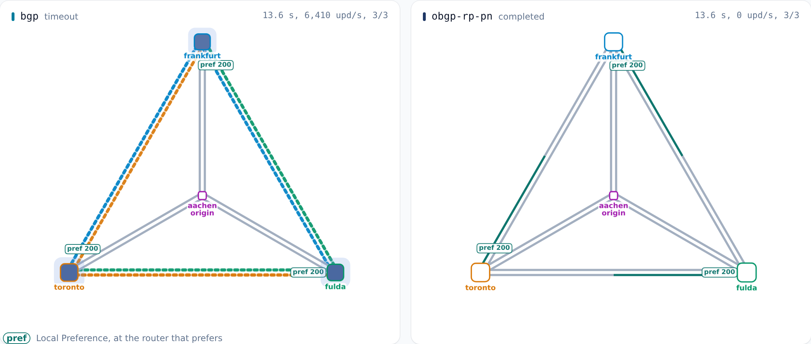
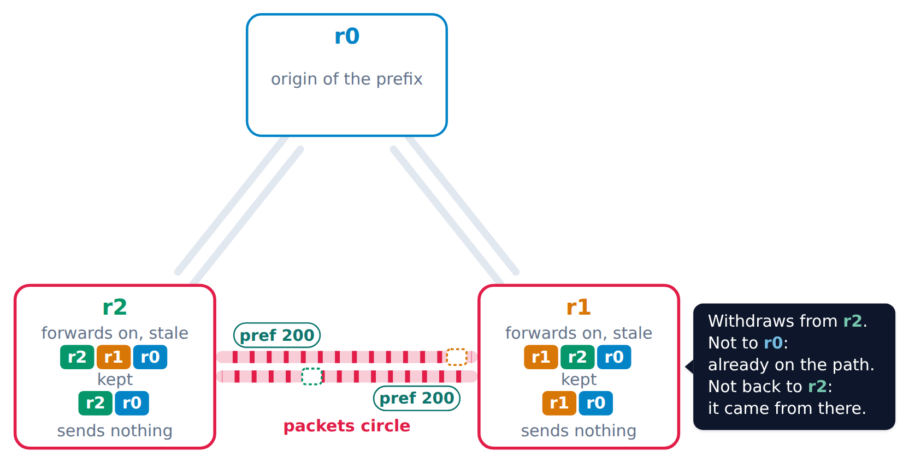

<p align="center">
  <picture>
    <source srcset="assets/logo-router-dark.png" media="(prefers-color-scheme: dark)">
    
  </picture>
</p>

<p align="center"><b>An oscillation-free BGP router based on <a href="https://github.com/osrg/gobgp">GoBGP</a>,<br>
and the lab that measures it.</b></p>

<p align="center">
<a href="https://doi.org/10.23919/IFIPNetworking70592.2026.11578986">IFIP Networking 2026</a>,
<a href="https://opendl.ifip-tc6.org/db/conf/networking/networking2026/1571247489.pdf">Paper</a>,
<a href="vis">Figures</a>,
<a href="results/public/ifip-networking-2026">Data</a>
</p>

Preference cycles make BGP oscillate. OBGP ([LCN 2022](https://doi.org/10.1109/LCN53696.2022.9843706),
[ICC 2022](https://doi.org/10.1109/ICC45855.2022.9839159)) orders route import and export strictly,
so that under the assumptions of its proof it cannot. BGP messages stay as they are.

- **Router:** gobgpd with OBGP, every part switchable back to the paper's code.
- **Lab:** BGP and OBGP on real routers in Kubernetes, from topology to statistics.
- **Agents:** AI assistants operate the lab over MCP. By default a person approves each change.
- **Simulator:** gobgpd's decision code on every small network, to find where OBGP deviates from BGP, replayed step by step in the lab's Simulation area.

## How it works

Paths are ordered by AS path length, ties broken by ASN.

- **Import:** a path is admitted only if it is better than the worst admitted one.
- **Export:** peers get the worst admitted path, so a better one never changes what they see.
- **Pruning:** a withdrawn or changed path sets aside the paths containing its old AS sequence.
- **Re-admission:** once no valid path is left, set-aside paths come back as their neighbors answer a route refresh.
- **Per neighbor (optional):** a table per eBGP neighbor, each exporting the worst path that neighbor may get.
- **iBGP:** paths from the own AS skip the import filter but count for the threshold.
- **Forwarding:** the FIB gets GoBGP's usual best path, loop-free once routes are at rest. With a table per
  neighbor lab and simulator check forwarding per ingress, as with NS-BGP: gobgpd installs no FIB per table.

What it costs: [Limitations](docs/router.md#limitations).

The modes since the paper have no published lab results yet.

## Router

Build, settings, modes and limitations: [docs/router.md](docs/router.md). Every design decision and what
the router supports: [DESIGN.md](DESIGN.md).

## Lab

<p align="center">
  <picture>
    <source srcset="assets/readme/process-dark.svg" media="(prefers-color-scheme: dark)">
    
  </picture>
</p>

Like Containerlab, Kathará and Mininet, the lab runs real daemons, one Kubernetes pod per router. It adds:

- **Experiments as files:** each result keeps its inputs, seeds and software versions.
- **Scenarios:** steps that announce, withdraw, fail links and change policies.
- **Checks:** every run for rest, loops, black holes, reach and policy against BGP of the same seed.
- **Statistics:** medians with exact intervals, paired variants with Wilcoxon tests.
- **Topologies:** drawn, generated, or from [SNDlib](https://sndlib.put.poznan.pl), [CAIDA](https://www.caida.org/catalog/datasets/as-relationships/) and [RIPE RIS](https://ris.ripe.net).

<p align="center">
  <picture>
    <source srcset="assets/readme/replay-dark.png" media="(prefers-color-scheme: dark)">
    
  </picture>
  <br><sub>A replay of BAD GADGET: BGP keeps sending updates, OBGP has come to rest.</sub>
</p>

One command sets it up on a Linux host with Docker. Then open the printed address and run `lab-smoke`.

```bash
git clone https://github.com/Stinktopf/gobgp.git && cd gobgp/scripts && ./setup.sh
```

- **Setup and host sizes:** [docs/setup.md](docs/setup.md)
- **Questions, metrics, checks and statistics:** [docs/evaluation.md](docs/evaluation.md)
- **Agents:** [docs/agents.md](docs/agents.md)

## Simulator

The simulator plays one prefix through every connected network of up to five routers, with gobgpd's own
decision and export code. It covers families of policies and events, such as Gao-Rexford relations, route
reflection, confederations, route servers, communities and filters, and runs each network in many orders of
messages. For every deviation from BGP, or of BGP itself, it keeps the smallest network: no rest, loops,
black holes, lost routes.

In the lab's Simulation area each finding plays step by step on one map: the routes of every router, the
messages on their way and, in a bubble, why a router decides as it does. *Play in the lab* turns it into an
experiment for the routers, and the result compares both sides case by case.

<p align="center">
  <picture>
    <source srcset="assets/readme/simulator-dark.png" media="(prefers-color-scheme: dark)">
    
  </picture>
  <br><sub>DISAGREE in the simulator: r1 and r2 prefer each other's route, and packets circle between them.</sub>
</p>

What it found: [DESIGN.md](DESIGN.md#what-the-router-supports). Running it: [docs/simulator.md](docs/simulator.md).

## Citation

```bibtex
@inproceedings{nickel2026obgp,
  author    = {Nickel, Lucas Immanuel and Rieger, Sebastian and Moghaddassian, Morteza and Garcia-Luna-Aceves, J. J.},
  title     = {Making {BGP-4} More Efficient and Oscillation-Free},
  booktitle = {2026 IFIP Networking Conference (IFIP Networking)},
  year      = {2026},
  pages     = {1--9},
  doi       = {10.23919/IFIPNetworking70592.2026.11578986}
}
```

## Acknowledgments

This work was supported by a fellowship of the German Academic Exchange Service (DAAD) and by
the Canada Excellence Research Chair in Intelligent Digital Infrastructures at the University
of Toronto, funded by the Tri-agency Institutional Programs Secretariat.

## License

[Apache License 2.0](LICENSE), like GoBGP. Logos and icons are in [`assets/`](assets).
